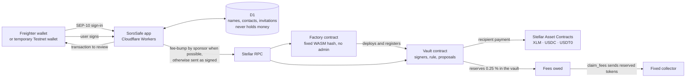

<p align="center">
  <picture>
    <source media="(prefers-color-scheme: dark)" srcset="public/brand/sorosafe-logo-white.svg">
    
  </picture>
</p>

# SoroSafe

English · [Español](README.es.md)

**A multisig vault for teams, on Stellar.** One address for shared funds, one address book for the team, and payments people understand before they approve.

**[Live demo (Testnet)](https://testnet.sorosafe.app)** · **[Contracts on stellar.expert](https://stellar.expert/explorer/testnet/contract/CDPSLPJELYXX33QRHLKHSEFY7ROSWYZ46I7DMSZNG3OGMVX6WURJRSSW)**

> SoroSafe runs on Stellar Testnet only. Test funds have no real value. The contracts have not been independently audited.

## The problem

Managing team money involves more than collecting signatures. Someone adds a supplier, another person prepares the payment, and teammates check it before funds move. When addresses, payment requests and approvals are scattered across personal address books and chats, the team has to reconstruct that context every time.

SoroSafe brings that work into one shared vault: the same recipients, visible approval rules and a payment history everyone on the team can check.

**Why we built it.** Corporate security guidance recommends spreading multisig signers across hardware wallets from different makers, so that a single compromised firmware can't move the funds. In practice, multisig on many networks works smoothly only through one wallet app and the devices it supports, so teams end up trading that security for convenience. A smart contract removes the dependency: it checks each signer's signature, whatever wallet or device produced it, and gives the team one shared place for requests, approvals and contacts.

## What SoroSafe does

- **A shared payment workflow.** One teammate saves a recipient, another prepares a payment, and the required signers review and approve it from their own wallets. Everyone works with the same vault and contacts.
- **Shared contacts with context.** The address book shows who added each contact and how many confirmed payments that address has received from this vault on-chain. A saved name is a team label, not identity verification.
- **Team-controlled approval rules.** Choose from 1 to 20 signers and any threshold from 1 to N. Changing signers or the threshold requires the current quorum and preserves the vault address. Its creator has no special withdrawal power.
- **One signature per decision.** Proposing a payment counts as your approval, and the approval that reaches the threshold sends the payment in the same transaction. If the vault can't cover it yet, the request waits and is completed once funds arrive.
- **Readable before signing.** Every request shows recipient, amount, service fee and total. The app rebuilds each transaction locally and checks contract, function and arguments before asking your wallet to sign, and checks that the recipient can receive the currency.
- **Simple setup.** Creating a vault takes a name and one wallet signature. It starts as 1 of 1; add teammates and raise the threshold before using it for shared approval.
- **Verifiable receipts.** Every confirmed operation links to the transaction and the vault contract on stellar.expert.
- **Bilingual.** Spanish and English throughout, including errors and confirmations.

## Why a smart contract

A multisig wallet asks everyone to sign the same transaction. A SoroSafe vault is a Soroban contract: it keeps the requests, counts the approvals and pays only when the rule is met.

| | Wallet multisig | SoroSafe vault (contract) |
| --- | --- | --- |
| Signing | Everyone signs the same transaction before it is sent | Each person approves on their own time, in their own transaction |
| Requests | A half-signed transaction passed around in chats | Stored on Stellar and visible to the whole team |
| What it can do | Any operation the account can do once the threshold is met | Only `Pay` in its approved currencies or `ChangeRules` |
| Stablecoins | A trustline and an XLM reserve per currency | Holds USDC and USDT0 directly, with no trustlines |

- **Each signer keeps the wallet they trust.** The contract checks each person's Stellar signature (`require_auth`), not an app or a hardware brand. With a rule of 2 or more, signers on devices from different makers mean one compromised device or firmware isn't enough to move the money. The app integrates Freighter today; more wallets are on the roadmap.
- **Team changes clean up after themselves.** Changing people or the rule needs the current quorum and keeps the vault's address. It bumps the rules epoch, so older pending requests stop counting and a removed signer's approval can never complete a payment.
- **Rules that hold without SoroSafe.** No admin key, no upgrade path and no SoroSafe withdrawal key; the code is checked against published hashes, and any client can operate the vault directly from Stellar.

The contract enforces the rule; it can't judge a payment the quorum chose to approve. Reviewing each request still matters, which is why the app shows everything before you sign.

## Why Stellar

- **Assets work with contracts.** Stellar Asset Contracts (SACs) let a Soroban vault hold and transfer XLM and issuer-backed assets. The demo uses Testnet XLM, Circle Testnet USDC and a SoroSafe-issued test USDT0; official Mainnet issuers are planned for launch.
- **Signatures are built in.** Soroban's `require_auth` binds every approval to the exact contract, function and arguments, so SoroSafe does not invent its own signature scheme.
- **Fees are tiny, and someone else can pay them.** A Stellar fee-bump lets SoroSafe pay the network fee for a transaction the user signed, without being able to change it.
- **Fast finality.** Stellar typically closes a ledger in about five seconds. Actual submission time depends on the network and transaction; a successful final approval and payment settle together.

## Try a shared payment

1. **Prepare two Testnet wallets.** Open **https://testnet.sorosafe.app** in two separate browser profiles. Use [Freighter](https://www.freighter.app/) on **Test Net**, or **Start without installing** (a temporary wallet) in each profile. Temporary wallets sign real Testnet transactions; they need no extension, and their keys remain in the tab's session storage until it closes. Keep both tabs open. Friendbot funds new accounts with test XLM.
2. **Create and configure the shared vault.** With the first wallet, create a vault, then open **Team**, add the second wallet's address and set **2 of 2** approvals. Sign the rule change under the initial 1-of-1 rule. Open the same vault URL in the second profile; both signers use this vault, rather than creating another one.
3. **Fund the vault and save a recipient.** In **Add funds**, use **Get 100 test XLM** (or **Get 10 test USDC**) and deposit it, leaving some XLM in your wallet for unsponsored network fees. Add a shared contact for a funded Testnet address you control; the first wallet's address can be used for this test payment.
4. **Prepare the payment as the second signer.** Open the shared contact and check who added it. Request a payment the vault can cover, including its 0.25% service fee. This signature records the first approval; funds remain in the vault while a second approval is needed.
5. **Review and complete as the first signer.** Check the recipient, selected asset, amount and fee, then choose **Approve and pay**. A successful final approval sends the payment in the same transaction.
6. **Verify it together.** Both signers can inspect the receipt on stellar.expert and the contact's updated confirmed-payment count. To try tokens next, use **Add funds** on the chosen token row; test USDT0 is issued by SoroSafe, not the official Mainnet issuer.

The [demo script](docs/VIDEO-SCRIPT.md) follows this shared workflow. [Submission copy in English and Spanish](docs/HACKATHON-SUBMISSION.md) describes the current Testnet scope.

## Network fees (gas)

SoroSafe pays the network fee for you **when it can**: it wraps the transaction you signed in a Stellar **fee-bump** and pays the fee in XLM from a sponsor account. The sponsor signs only the outer envelope, so it cannot change the call or authorize anything in a vault.

- Sponsored: proposals, approvals (which also send the payment), cancellations, team changes and adding funds to a SoroSafe vault; on Testnet also the faucets.
- Not sponsored: creating a vault, or any call outside SoroSafe's verified vaults.
- Limits: at most 1 XLM per transaction and 20 sponsored transactions per account per day.
- If sponsorship isn't possible (limit reached, sponsor low on funds), the app falls back to submitting the signed transaction with the signer's wallet paying the network fee. That wallet must have enough XLM; insufficient funds or network errors can still prevent completion.

## Business model

- A **0.25 % service fee** on outgoing payments, recorded atomically with the payment in the same currency and rounded up to the token's smallest unit. Sending 2 USDT0 requires 2.005 USDT0: the recipient receives 2 and 0.005 stays reserved in the vault for the collector.
- Reserved fees cannot fund another payment. Anyone can call `claim_fees` to send them to the fixed collector; the caller cannot choose another destination. A collector that cannot receive can block that withdrawal, but does not block payments to other eligible recipients.
- The service fee supports the product and network-fee sponsorship. Sponsored network fees do **not** make outgoing payments free: the 0.25 % service fee still applies.
- Sponsorship is capped (1 XLM per transaction, 20 transactions per account per day) so the cost stays bounded.
- Deposits and team changes carry no service fee. There is no extra service fee per approval; the approval that executes a payment records that payment's fee.

## How it uses Stellar

| Piece | What it does |
| --- | --- |
| **Vault contract (Soroban)** | Holds SAC tokens (XLM, USDC, USDT0). Stores signers, threshold and proposals. `propose`, `approve`, `revoke`, `cancel`, `execute`. Signers are authenticated with `require_auth`, so each approval is bound to the exact contract, function and arguments. |
| **Factory contract** | Deploys one vault per team from a fixed WASM hash with a deterministic, creator-namespaced salt, and registers it (`is_vault`) so the app can verify a vault's origin. No admin, no upgrade, no withdrawal key. |
| **Team changes** | `ChangeRules` proposals need the current quorum. Applying one bumps an epoch that invalidates every older pending request. |
| **Fees** | Service fee in the same token, computed with OpenZeppelin's audited fixed-point math (`mul_div_ceil`) and recorded atomically with the payment; it stays reserved in the vault until `claim_fees` sends it to the collector. |
| **Stellar Asset Contracts** | Assets are identified by contract + issuer and resolved to their deterministic SAC addresses. A ticker alone never identifies a token. |
| **Fee-bump** | The sponsor pays network fees for verified vault calls when it can (see [Network fees](#network-fees-gas)). |
| **Freighter + SEP-10** | Wallet-based sign-in. The server never sees or stores user keys. |
| **Stellar RPC** | Simulation, submission and all balances, proposals and approvals are read from the chain. |

Collaboration data (names, contacts, invitations) lives in Cloudflare D1. It never holds or controls money: `/contract?network=testnet&address=C…` can read and operate any vault directly from Stellar without SoroSafe's backend.

## Architecture



Repository layout (internal codename **junto**: package name, `JUNTO_*` environment variables, `junto_*.wasm`):

```
contracts/            Rust, soroban-sdk 26
  vault/              shared vault: proposals, approvals, quorum, accrued fee
  factory/            deploys and registers vaults from a fixed WASM hash
  types/              rules and protocol validation shared by both
app/                  React UI and API routes (vinext on Cloudflare Workers)
lib/                  Stellar RPC client, SEP-10 auth, transaction checks
db/, drizzle/         D1 schema and migrations for collaboration data
scripts/              contract build, Testnet factory and Cloudflare deploy
tests/                offline regression suites and live Testnet flows
docs/                 security model, evidence files, video script
```

## Deployed on Testnet

All addresses link to [stellar.expert](https://stellar.expert/explorer/testnet). The source of truth is `lib/testnet-tokens.json`, `lib/contract-artifacts.json` and `docs/testnet-demo-factory.json`.

| What | Address |
| --- | --- |
| App | https://testnet.sorosafe.app (Cloudflare Workers + D1) |
| Factory | [`CDPSLPJELYXX33QRHLKHSEFY7ROSWYZ46I7DMSZNG3OGMVX6WURJRSSW`](https://stellar.expert/explorer/testnet/contract/CDPSLPJELYXX33QRHLKHSEFY7ROSWYZ46I7DMSZNG3OGMVX6WURJRSSW) |
| Vault WASM SHA-256 | `7c95b9a72fdc9fd242d7b44214ab53f46018e62e28ff68500b71e1b1af2d023d` |
| Factory WASM SHA-256 | `8b78a84b1186e59e31e94f9352ff2fd1e8ffa1ea31ca43099a0fca949e9477ca` |
| XLM (SAC) | [`CDLZFC3SYJYDZT7K67VZ75HPJVIEUVNIXF47ZG2FB2RMQQVU2HHGCYSC`](https://stellar.expert/explorer/testnet/contract/CDLZFC3SYJYDZT7K67VZ75HPJVIEUVNIXF47ZG2FB2RMQQVU2HHGCYSC) |
| XLM faucet | [`CAHDSZQMAG43HPFXUSQ5QS7ZXB3IMXEBEEEJO22RPIWJWWRZC4OOVLNG`](https://stellar.expert/explorer/testnet/contract/CAHDSZQMAG43HPFXUSQ5QS7ZXB3IMXEBEEEJO22RPIWJWWRZC4OOVLNG) (100 XLM per account per day) |
| USDC (Circle Testnet, SAC) | [`CBIELTK6YBZJU5UP2WWQEUCYKLPU6AUNZ2BQ4WWFEIE3USCIHMXQDAMA`](https://stellar.expert/explorer/testnet/contract/CBIELTK6YBZJU5UP2WWQEUCYKLPU6AUNZ2BQ4WWFEIE3USCIHMXQDAMA), issuer [`GBBD47IF…LFLA5`](https://stellar.expert/explorer/testnet/account/GBBD47IF6LWK7P7MDEVSCWR7DPUWV3NY3DTQEVFL4NAT4AQH3ZLLFLA5) |
| USDC faucet | [`CAHA4GQU75Y7QJX64AYUTYBP6GPGTS7LGWKI3DIKQ57JFUIE2F6Y7SKD`](https://stellar.expert/explorer/testnet/contract/CAHA4GQU75Y7QJX64AYUTYBP6GPGTS7LGWKI3DIKQ57JFUIE2F6Y7SKD) (top up with `node scripts/fund-testnet-faucets.mjs`, or [Circle's faucet](https://faucet.circle.com/)) |
| USDT0 (SoroSafe test, SAC) | [`CCQOQVXDBJXRP52V34GYSD7XTTJXY27NUQDNBW2MHRZG6TEF2HCSUMKP`](https://stellar.expert/explorer/testnet/contract/CCQOQVXDBJXRP52V34GYSD7XTTJXY27NUQDNBW2MHRZG6TEF2HCSUMKP), issuer [`GCCYRCUZ…J5S4`](https://stellar.expert/explorer/testnet/account/GCCYRCUZU36KZCHRJX7AFWHRTE7ZRJ3VKRBMTQC5VNIZ3KZ5T77PJ5S4) |
| USDT0 faucet | [`CAVLWTDJCALTUZY47ECCAOOCBGF6R4S7I3NI637SZX33VDI6FZNERVXZ`](https://stellar.expert/explorer/testnet/contract/CAVLWTDJCALTUZY47ECCAOOCBGF6R4S7I3NI637SZX33VDI6FZNERVXZ) |
| Gas sponsor | [`GCREJ6HQVT4TR4AV3FDGQVXB7BEI4KDAI2UFCT7CJYWJOE7N3NPJD2FQ`](https://stellar.expert/explorer/testnet/account/GCREJ6HQVT4TR4AV3FDGQVXB7BEI4KDAI2UFCT7CJYWJOE7N3NPJD2FQ) |
| Fee collector | [`GDZGXG7Y3FYOZ7AFUDO6GLQCIUMWIMBHANYM7FAVORP46VOU572YNIG7`](https://stellar.expert/explorer/testnet/account/GDZGXG7Y3FYOZ7AFUDO6GLQCIUMWIMBHANYM7FAVORP46VOU572YNIG7) |

The app checks both WASM hashes and the factory registration on-chain before operating a vault.

**Test funds in one click.** On Testnet, **Add funds** shows a button for each currency: **Get 100 test XLM**, **Get 10 test USDC** and **Get 1000 test USDT0** (once a day per account; the button adds the trustline when needed). These buttons and faucets exist only on Testnet; the app never renders them on Mainnet.

**About USDT0 on Testnet.** USDT0 has no official Testnet deployment, so SoroSafe issued a fixed-supply test USDT0 (issuer locked after minting) held by a faucet contract: **Add funds → Get 1000 test USDT0** adds the trustline and claims it (once a day per account). Mainnet will use the official USDC and USDT0 issuers.

### Proof on-chain

[This transaction](https://stellar.expert/explorer/testnet/tx/b989375a632c0874a8b0622efb0fb2e5c57ca4bf9b50d1e1dabefd0bd85611e1) is the second signer's single approval on a 2-of-2 vault. In one transaction it records the approval, sends **2 USDT0** to the recipient and charges the **0.005 USDT0** (0.25 %) service fee. (This receipt comes from the previous factory, which sent the fee straight to the collector; the current contracts keep it owed in the vault until `claim_fees`.) It is a fee-bump: the fee source account is the SoroSafe gas sponsor, so the signer paid no XLM.

More receipts from automated Testnet runs are in `docs/soroban-testnet-evidence.json` and `docs/testnet-demo-factory.json`.

## Verification

| Suite | Result |
| --- | --- |
| Rust contract tests (`npm run contracts:test`) | 35/35 (vault 28, factory 5, faucet 2) |
| Real Testnet flow with Friendbot wallets (`npm run test:soroban`) | 21/21, receipts in `docs/soroban-testnet-evidence.json` |
| End-to-end sign-up and vault creation through the API (`tests/contracts-onboarding.mjs`) | 19/19, also run against the deployed app |
| Backend regression tests (`npm run test:audit-regressions`) | 36/36 |
| Client transaction encoding (`npm run test:contracts-client`) | passes (1..20 signers, threshold 1..N, asset identity) |

## Run locally

Node 22.13+, Rust 1.94.1 with target `wasm32v1-none`, Stellar CLI 25.2.0+.

```sh
npm ci
npm run db:local && npm run db:local:upgrade && npm run db:local:contracts \
  && npm run db:local:auth && npm run db:local:auth-limits && npm run db:local:attempts
node scripts/setup-local-auth.mjs
# .dev.vars: JUNTO_NETWORK=testnet and JUNTO_FACTORY=<factory C… address>
npm run dev -- --host 127.0.0.1 --port 8789
```

Build and test the contracts with `npm run contracts:build && npm run contracts:test`. `npm run contracts:deploy-testnet` deploys a fresh demo factory with ephemeral Friendbot accounts; `npm run deploy:testnet` publishes the app to Cloudflare.

## Security & Mainnet readiness

- **Not independently audited.** Read [the security model](docs/CONTRACT-SECURITY.md) for risks and open items.
- **Testnet only.** No SoroSafe factory has been deployed to Mainnet.
- V1 only moves the SAC tokens listed when the factory was deployed. No arbitrary calls, allowances or upgrades.
- Signers are Stellar G accounts. Freighter is the integrated wallet; passkeys and more wallets are planned.
- A classic payment or an exchange withdrawal that requires a memo must not be sent to a vault's C… address.

### Contract fixes in this release

Fixed after an internal review of the contracts (all covered by tests):

- **Fees can't freeze payments.** The service fee is no longer pushed to the collector inside each payment. It accrues in the vault (`fees_owed`) and anyone can sweep it with `claim_fees`. If the collector loses its trustline or gets frozen, only the sweep fails; payments keep working. Payments can never spend fees that are owed.
- **Unfunded requests stay pending.** In a 1-of-1 vault, a payment the vault can't cover yet is saved as a pending request instead of reverting, and runs later with "Complete payment".
- **Amounts the token can't move are rejected** (amount + fee above the Stellar asset limit).
- **Withdrawing an approval you never gave fails with a clear error** instead of emitting a misleading event.
- **Recipient checks reduce failed transfers.** The app checks whether a recipient account exists and can hold the currency before proposing or approving. Its trustline, authorization or network state can change afterward, so these checks do not guarantee execution.
- **Sponsorship has a fallback.** If the fee-bump cannot be sponsored or is rejected before reaching the ledger, the app can submit the signed transaction with the signer paying. The signer still needs enough XLM, and normal network checks apply; a pre-ledger rejection does not consume the daily sponsorship allowance.

### Before Mainnet

- [ ] Independent external audit of the vault and factory WASM and the app's signing flow.
- [ ] Storage TTL keeper that keeps vault instances, code and proposals live (and a restore path for archived entries).
- [ ] Sponsor rate limits tuned for Mainnet, with monitoring of the sponsor's XLM balance.
- [ ] Fee collector account on a hardware wallet or a multisig.
- [ ] No faucets on Mainnet: only the official USDC and USDT0 issuers.

## Roadmap

1. **Mainnet launch.** Mainnet factory with XLM, USDC and USDT0 (official SAC addresses already verified read-only).
2. **Team workflow.** Notifications when a payment waits for your approval, and invite links for new signers.
3. **Easier wallets.** Passkeys and smart wallets, plus more wallets (including mobile) through Stellar Wallets Kit.
4. **Independent audit** before holding meaningful funds.

## Team

- **Fabián Fariñas** ([@ffarinas](https://github.com/ffarinas)) · Founder, product & engineering

## License

[MIT](LICENSE)
